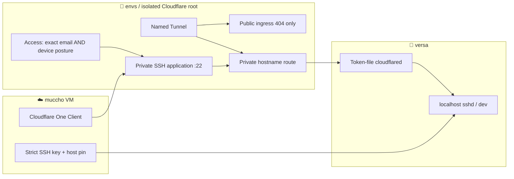

# Independent Versa Cloudflare private hostname root

Source proposal for [resources #143](https://github.com/roccho-dev/resources/issues/143) and [resources PR #147](https://github.com/roccho-dev/resources/pull/147).

**Not applied.** This directory defines an independent Cloudflare Tunnel, its deny-all published ingress, a private hostname route and a private Access application for one exact enrollment email + one device-posture check. It adds no GitHub workflow capable of applying a Provider change.

## Scope

- Only `muccho → versa/dev` on `versa.roccho.internal:22`; `g6i3.roccho.com`, rent and existing Provider state do not change.
- Public DNS CNAME, public hostname, Access bypass, Service Auth shared with rent, new SSH server and any LAN subnet routes are absent.
- Actual muccho enrollment email, device-posture check ID, account ID, separate encrypted backend and provider credential must be supplied by the authorized owner at execution. Do not commit any value or token.
- `providers/dev-rent-cloudflare` retains its own locked state, token delivery and access policy. This proposal does not import or touch it.

## Provider dependencies

## Apply admission — source alone does not grant approval

1. Read Cloudflare current account state and network rules. Refuse any untracked preexisting Tunnel/hostname collision; **never create a second root managing existing g6i3 resources**.
2. Confirm the real muccho VM can run/enroll Cloudflare One Client in DNS/traffic mode, prove its exact email and device-posture check, and test the Gateway policy order against any existing network policy. If unavailable, stop; no published DNS fallback.
3. Before any private route, establish a fail-closed policy for non-muccho devices. The graph depends on the Access app, but that alone does **not** prove effective Gateway / Access enforcement. Readback must show unauthorized devices cannot reach the target before accepting the route.
4. Use a distinct encrypted state/backend, apply only an exact approved plan and confirm created/destroyed/modified objects. Existing G6/rent Provider objects, secrets, policies and routes have zero diff.
5. Deliver the separate Tunnel token through envs custody to the Versa root-only `/var/lib/versa-cloudflared/token` outside source/store. Configure a separate muccho SSH key for the `dev` user and pin existing host key; no credential sharing.
6. Confirm successful muccho SSH + representative Agent response and refusal for wrong device, wrong SSH key, wrong host pin, root and other Hosts; check reconnect, reboot, revocation and unchanged LAN recovery. Record evidence at #143.

## Destruction tests (must be rejected)

1. Public CNAME or published ingress added.
2. LAN subnet/CIDR route instead of single private hostname.
3. Account, Tunnel or Provider state reused from g6i3/rent.
4. WARP device cannot run in the muccho VM.
5. Access policy accepts any email or any device.
6. Route created before narrow app/policy is active.
7. Gateway policy order permits unauthenticated private SSH.
8. Wrong SSH identity or host pin accepted.
9. `root` accepted or existing management key copied to muccho.
10. Secret logged, committed or copied into the Nix store.
11. Removal blocks existing g6i3, rent or LAN access.
12. Service healthy but Agent execution/return or reboot recovery fails.

Keep this root Draft until provider validation, policy admission, exact state custody and independent live acceptance. Native provider schema check is performed in the existing effect-toolchain CI (backend disabled, proxy denied).

References: [Cloudflare private hostname](https://developers.cloudflare.com/cloudflare-one/networks/connectors/cloudflare-tunnel/private-net/cloudflared/connect-private-hostname/), [private Access](https://developers.cloudflare.com/cloudflare-one/access-controls/applications/non-http/self-hosted-private-app/).
