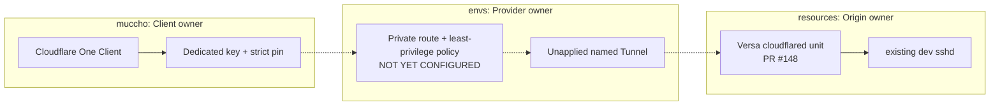

# Versa private SSH Tunnel — provider source only

Purpose: `roccho-dev/resources#143`, muccho VM -> Versa `dev` SSH, without
publishing any Versa application or changing g6i3, rent, rent.oci or rent.win.

This root defines **only** a separately managed `versa-private-ssh` tunnel and
its sensitive connector token. No public DNS, published hostname, private
hostname route, WARP client enrollment, Gateway rule, state migration, or
apply workflow is created. It is NOT activated by CI or by merging this PR.

Next gates, in order:
1. Read actual Cloudflare account/Zero Trust enrollment state and existing
   Provider state before creating or importing `versa-private-ssh`.
2. Choose one private hostname and prove how its origin resolves to **only**
   Versa's SSH endpoint. No route to entire LAN or all loopback services.
3. Establish deny-by-default Gateway/private-network authorization and explicit
   allow only for muccho machine identity to SSH port 22, with negative tests
   for other devices and ports. An enrolled client is not automatically trusted.
4. Only then apply a bounded private route (not public DNS/ingress), deliver
   the connector token to the protected Versa file, enroll muccho and
   install a dev-only key and verified host pin.
5. Observe real job delegation and response, reconnect/reboot, rejected
   credentials/ports, and unchanged g6i3/rent/LAN paths.

Source/CI validation is not Provider apply or connectivity evidence. State and
plans must remain encrypted; an output marked sensitive still resides inside
the encrypted Provider state and must not appear in logs, Git, CLI args,
public artifacts or Nix store. No automatic cleanup may revoke the existing
g6i3 Tunnel.

References:
- https://github.com/roccho-dev/resources/issues/143
- https://github.com/roccho-dev/resources/pull/148
- https://developers.cloudflare.com/cloudflare-one/networks/connectors/cloudflare-tunnel/private-net/
- https://developers.cloudflare.com/tunnel/reference/tunnel-tokens/
